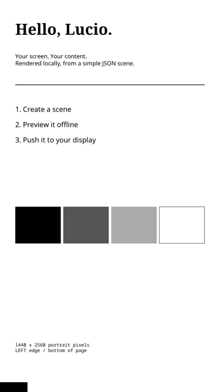

# Lucio

**Your content, on your e-paper display. Rendered locally.**

Lucio is a small Go toolkit for a configured 32-inch Visionect/Joan PP32 display.
Describe a page in JSON, preview it as a PNG, then explicitly send it over your
LAN. A lightweight daemon handles the screen connection; content generation
stays outside it.



## What it does

- **Renders offline.** Text, images, cards, lists, grids, and stacks on a
  1440 × 2560 portrait canvas, with bundled fonts and useful layout errors.
- **Drives one screen.** A local PV3 gateway owns delivery, device ACKs, and
  conservative partial-update decisions. Full refresh is the default.
- **Makes updates explicit.** Nothing is sent just because the daemon starts
  or the screen reconnects. There is no persistent image queue.
- **Offers local diagnostics.** Cached status and optional, rotating event logs
  with observational battery reports. No analytics are sent anywhere.
- **Keeps content clients separate.** The optional [Paperboy](docs/paperboy.md)
  fetches front-page PDFs or renders a local PDF; the daemon does neither.

Lucio is not a multi-screen signage platform, web dashboard, public REST API,
or general-purpose Visionect implementation.

## Compatibility and status

**Experimental; a narrow hardware target.** The local display workflow has been
exercised on PP32 v1.1 / Joan, firmware/bootloader 6.9.3947. The refactored code
passes software and simulated-screen tests; it still needs a physical-device
acceptance run. Other panels/firmware and factory-reset provisioning are unproven.

Lucio replaces vendor server software for that configured display path. It does
**not** establish that device firmware never contacts outside services. Enforce
and verify network isolation separately if you require it.

## Try it without a screen

With **Go 1.26.8 or a newer patched release**, from a checkout:

```sh
go build -trimpath -o bin/lucio ./cmd/lucio
./bin/lucio render --scene examples/hello.json --out /tmp/hello.png
```

Open `/tmp/hello.png`. No daemon, Internet access, external fonts, Python, or PDF
tools are needed for rendering. Building on macOS needs Xcode command-line tools
because USB enumeration uses cgo; Linux can build with `CGO_ENABLED=0`.

Create your own scene:

```sh
./bin/lucio init --template dashboard > scene.json
./bin/lucio render --scene scene.json --out /tmp/scene.png --report /tmp/report.json
./bin/lucio describe
```

See [scenes and rendering](docs/scenes.md) for primitives, assets, validation,
and the schema. A failed render never replaces the PNG: check the exit status,
not just whether an old output file exists.

## Connect a configured display

Read [setup](docs/setup.md) before changing device settings. Run Lucio on the
screen's LAN:

```sh
./bin/lucio serve
```

The screen connects to TCP **11113**. Private CLI control listens on
**127.0.0.1:18080**. In another terminal on that server:

```sh
./bin/lucio status
./bin/lucio push --scene examples/hello.json --wait
```

`--wait` follows that specific update until a matching device ACK or failure;
it is not optical proof of what is on the panel. Status is cached, not a live
query that wakes the screen.

**Trust boundary:** the gateway and local IPC have no user authentication or
built-in TLS. Do not expose them to the Internet. Restrict the gateway to the
screen's network; use SSH for remote administration. See
[operations](docs/operations.md) for systemd, logs, full/partial behavior, and
rollback.

## How the pieces fit

```text
scene JSON + local assets
          │
          ▼
  lucio render / push ──► PNG + layout report
          │ push only
          ▼
   private local IPC
          │
          ▼
      lucio serve ◄────── screen-initiated LAN connection
          │
          └────────────► image update → matching device ACK
```

The renderer has no socket knowledge. The daemon has no scene, font, or content
fetching knowledge. [Architecture](docs/architecture.md) explains ownership and
update lifecycle; [protocol notes](docs/protocol.md) document the supported wire
format and pixel mapping.

## Install, contribute, and report problems

Build from source as above. The [release tooling](docs/releases.md) creates
Linux and macOS archives containing both binaries, docs, examples, and license
notices; nothing is installed or deployed automatically.

- [Contributing and tests](CONTRIBUTING.md)
- [Security boundaries and reporting](SECURITY.md)
- [USB setup](docs/setup.md#3-inspectconfigure-usb-only-if-necessary)
- [Optional Paperboy](docs/paperboy.md)

Bug reports are most useful with `lucio version --json`, a minimal synthetic
scene, and a redacted report. Do not attach Wi-Fi credentials, private content,
device captures, or unreviewed event logs.

## License

[MIT](LICENSE) for Lucio code and original examples. Bundled Noto fonts use the
[SIL Open Font License](internal/renderer/fonts/OFL.txt); dependency notices are
in [THIRD_PARTY_NOTICES.md](THIRD_PARTY_NOTICES.md). Visionect and Joan belong to
their respective owners. Lucio is independent, not affiliated with or endorsed
by Visionect.
